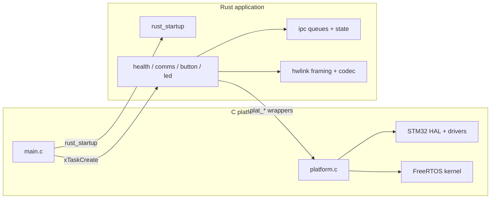

# Architecture

This page describes the mixed C/Rust design of `app-rust-freertos`. The point
of this repository is to keep the proven C board layer and move application
logic to `no_std` Rust, so the boundary between the two languages is the most
important part of the design.

## Layers

```text
┌──────────────────────────────────────────────────────────────┐
│ Rust application (src/)                                      │
│   app/health, app/comms, app/button, app/led                 │
│   app/ipc (queues and shared state), app/fault, app/identity │
│   protocol/hwlink (COBS, CRC-32, FlatBuffers)                │
├──────────────────────────────────────────────────────────────┤
│ FFI: extern "C" functions declared in platform/platform.h    │
│   Rust -> C: plat_*() wrappers in src/platform/plat.rs       │
│   C -> Rust: rust_startup() and rust_*_task()                │
├──────────────────────────────────────────────────────────────┤
│ C platform (platform/)                                       │
│   main.c, platform.c, drivers/, boot/, fault/, log/, rtos/   │
│   STM32 HAL, FreeRTOS kernel, board start-up, boot contract  │
└──────────────────────────────────────────────────────────────┘
```

`src/lib.rs` is a `staticlib`. CMake builds the C platform and the FreeRTOS
kernel first, then calls Cargo for the Rust archive and links it after the C
objects. `platform/main.c` is the entry point: it does everything that must
happen before a Rust runtime can exist, calls `rust_startup()`, creates the
four Rust task entry points and starts the scheduler.

## The FFI boundary

The C header `platform/platform.h` is the contract. `src/platform/plat.rs`
declares the same functions in an `extern "C"` block and wraps each one in a
safe Rust function. The wrappers are the only Rust code that calls C.

| Direction | Mechanism | Examples |
|---|---|---|
| Rust → C | `plat_*()` wrappers | `plat_log`, `plat_uart_send`, `plat_confirm_running_slot`, `plat_wdt_feed` |
| C → Rust | `#[no_mangle] extern "C"` | `rust_startup`, `rust_health_task`, `rust_comms_task`, `rust_button_task`, `rust_led_task` |



Every Rust wrapper upholds the same safety contract: the C function either
takes no pointer, or takes a pointer plus the matching length/buffer, checks
its own bounds and does not retain the pointer. Rust owns the buffer for the
whole call. The wrappers go through one documented `ffi_call!` macro, and
`#![deny(clippy::undocumented_unsafe_blocks)]` keeps it that way.

`scripts/check_ffi.py` compares the `extern "C"` declarations on both sides:
every Rust `plat_*` function must exist in `platform/platform.h` with the same
number of parameters. This is not a replacement for bindgen, but it catches
the common drift (a parameter added to only one side) at PR time without
generating code that nobody reads.

## Ownership

| Concern | Owner | Why |
|---|---|---|
| Vector table, clocks, caches, MPU | C (`platform/`) | Must run before Rust and is already proven |
| FreeRTOS kernel and task creation | C (`platform/main.c`, `platform/rtos/`) | The kernel is a C library; Rust only supplies task bodies |
| STM32 HAL drivers | C (`platform/drivers/`) | Reuse the existing, reviewed driver layer |
| Boot hand-over and `CONFIRMED` record | C (`platform/boot/`) | The flash write is the bootloader contract |
| Fault record and fatal path | C (`platform/fault/`) | Reachable from any C or Rust fault |
| Debug log transport | C (`platform/log/`) | USART6 DMA and the existing line format |
| Application tasks and state machines | Rust (`src/app/`) | The part being migrated |
| HWLINK framing, CRC and FlatBuffers | Rust (`src/protocol/`) | Pure logic, tested on the host |
| Shared state and queues | Rust (`src/app/ipc.rs`) | Owned by the Rust tasks |

The rule is simple: hardware and kernel stay in C until there is a reason to
move them; application behaviour goes to Rust.

## Memory and allocation

The Rust side is `#![no_std]` and has no allocator. Queues and shared state
are fixed-size `static` values created at compile time. The C side creates the
task stacks with `xTaskCreate` before the scheduler starts, so nothing
allocates after `vTaskStartScheduler()`.

| Address | Size | Use |
|---|---:|---|
| `0x08000000` | 32 KB | BOOT, sectors 0..1 |
| `0x08008000` | 16 KB | metadata sector for the running slot |
| `0x0800C000` | 976 KB | application slot / running image |
| `0x08108000` | 16 KB | metadata sector for the other slot |
| `0x0810C000` | 976 KB | application slot in bank 2 |

The current release build uses about 46 KB of flash and 20 KB of static RAM.
`scripts/check_footprint.py` fails the build above 128 KB flash or 64 KB RAM.

## Task model

The four tasks are created by C with fixed priorities and stacks; their bodies
are Rust functions with the FreeRTOS `TaskFunction_t` signature.

| Task | Priority | Stack (words) | Rust entry | Responsibility |
|---|---:|---:|---|---|
| Health | 5 | 1024 | `rust_health_task` | check-ins, watchdog feed, trial check, `CONFIRMED` |
| Comms | 4 | 1536 | `rust_comms_task` | USART3, HWLINK commands and replies |
| Button | 3 | 512 | `rust_button_task` | B1 debounce and press classification |
| LED | 2 | 512 | `rust_led_task` | LD1/LD2/LD3 patterns and LD3 status |

Health is the only watchdog feeder and the only task that writes the
`CONFIRMED` record. The LED task is the only writer of the LED pins, and the
comms task is the only reader of USART3. Shared state goes through the queues
and critical-section-protected values in `src/app/ipc.rs`; there are no
`static mut` accesses in the application tasks.

## Boot hand-over

1. BOOT writes the hand-over word to `RTC_BKP2R` and maps the active bank.
2. C `main()` sets `VTOR`, kicks the IWDG, captures the reset cause and
   decodes the hand-over record. It starts the clock, caches, MPU, fault
   handlers, log, GPIO, IWDG and USART3.
3. C calls `rust_startup(reset_cause, slot, trial, trial_count)`. Rust stores
   the boot info, logs the start line, checks `VTOR` and latches the LD3 fault
   indication.
4. C creates the four tasks and starts the scheduler.
5. If the slot is on trial, Health waits five seconds, checks the task
   check-ins and then writes `CONFIRMED` through `plat_confirm_running_slot()`.
   On failure it stops feeding the watchdog after ten seconds so BOOT rolls
   back.

## Debugging across the language boundary

The debug log is USART6 at 115200 8N1. `make serial` opens the ST-LINK VCP.

A GDB session that steps from C into Rust works without special setup because
the Rust symbols are in the same ELF:

```console
$ make gdbserver            # terminal 1: OpenOCD on :3333
$ gdb-multiarch build/rust-freertos-app.elf
(gdb) target extended-remote :3333
(gdb) monitor reset halt
(gdb) break main
(gdb) continue
(gdb) break rust_startup
(gdb) continue
(gdb) step                  # steps from C into the Rust function body
(gdb) bt                    # mixed C/Rust frames
```

When the target faults, `platform/fault/app_fault.c` saves the fault record in
the no-init DTCM window. `make debug` (or a reset after the fault) shows the
reason, PC, LR, CFSR, HFSR, MMFAR and BFAR in the start-up log and in the
`Status` reply. `plat_fault_get()` copies the record into Rust for `Status`.

## Migrating a C product one module at a time

This repository is the template for that path:

1. Keep the C start-up, linker script, HAL drivers, kernel and bootloader
   contract exactly as they are.
2. Add an FFI header (`platform/platform.h`) with the small set of services
   Rust needs. Wrap each function in `src/platform/plat.rs`.
3. Move one application module to Rust. Give it a `staticlib` crate and a
   task entry point that C can create.
4. Keep ownership explicit: only one side writes a hardware register or a
   shared object, and document it in the table above.
5. Add the module to the host tests if it is pure logic. Keep hardware access
   behind the FFI so it stays testable.
6. Grow the Rust side module by module. The C side shrinks, but the boot and
   driver layer does not have to be rewritten.

## Quality gates

| Target | What it checks |
|---|---|
| `make build` | C + Rust build, image header, footprint |
| `make lint` / `make lint-strict` | clang-tidy over the C platform |
| `make clippy` | clippy with `-D warnings` and undocumented unsafe denied |
| `make test-host` | HWLINK framing tests on the host |
| `make ffi-check` | Rust extern declarations against `platform/platform.h` |
| `make boot-contract` | slot and metadata constants against the BOOT layout |
| `make image-check` | image magic, load address, CRC and reset vector |
| `cargo audit` / `cargo deny` | dependency advisories, licences and sources |

## Where to look

| Topic | Source |
|---|---|
| C entry point and task creation | `platform/main.c` |
| Rust entry point and panic handler | `src/lib.rs` |
| FFI wrappers | `src/platform/plat.rs` |
| C platform services | `platform/platform.c`, `platform/platform.h` |
| Application tasks | `src/app/` |
| Protocol | `src/protocol/hwlink/` |
| Host protocol tests | `protocol/hwlink-tests/` |
| Boot contract | `platform/boot/boot_contract.h` |
| Linker scripts | `ld/` |
